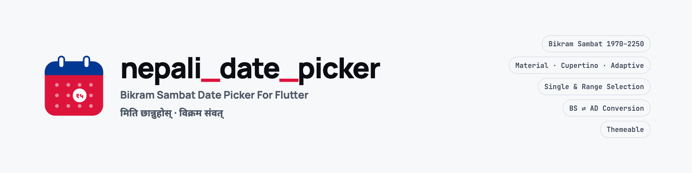
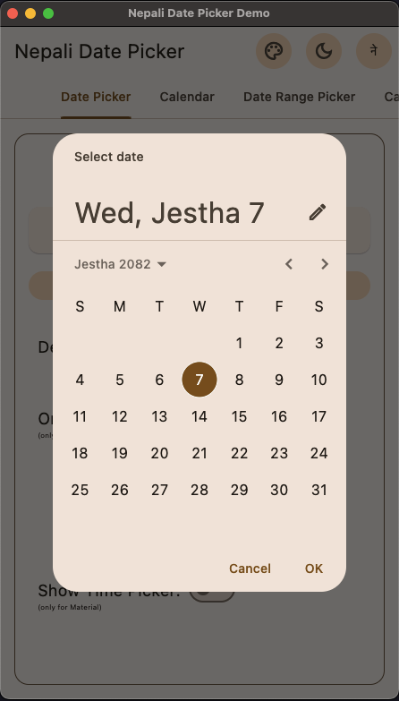
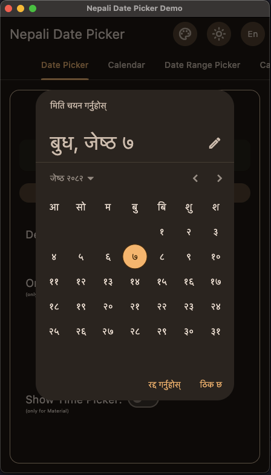
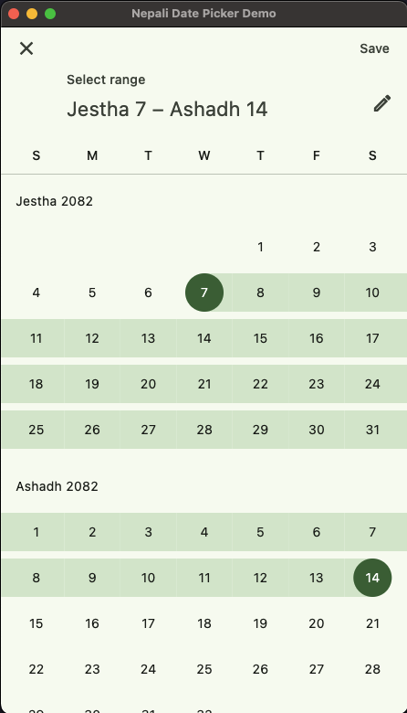

<picture>
  <source media="(prefers-color-scheme: dark)" srcset="https://raw.githubusercontent.com/sarbagyastha/nepali_date_picker/main/assets/ndp-banner-dark.png">
  
</picture>

<p align="center">
  <a href="https://pub.dev/packages/nepali_date_picker"></a>
  <a href="https://pub.dev/packages/nepali_date_picker/score"></a>
  <a href="https://pub.dev/packages/nepali_date_picker/score"></a>
  <a href="https://github.com/sarbagyastha/nepali_date_picker/blob/main/LICENSE"></a>
  <a href="https://date.sarbagyastha.com.np"></a>
</p>

<p align="center">
  🇳🇵 A customizable, fully localized date picker for Flutter, built for the <b>Nepali (Bikram Sambat)</b> calendar.
</p>

---

## ✨ Features

| | |
|---|---|
| 🗓️ **Bikram Sambat calendar** | Full support from **1970 BS** to **2250 BS** |
| 📱 **Three styles** | Material, Cupertino, and adaptive pickers |
| 🎯 **Single & range selection** | Pick one date or a whole range, in a dialog or inline |
| 🌐 **Localized** | English and Nepali (नेपाली), following the phone's locale by default |
| 🕒 **Time zone aware** | "Today" follows the device, or Nepal time with one flag |
| 🔄 **BS ⇄ AD** | Effortless conversion between Bikram Sambat and Gregorian dates |
| 🎨 **Themeable** | Inherits your app's Material theme, light and dark |
| ⚡ **Fast** | A lightweight `CalendarDelegate` built on [`nepali_utils`](https://pub.dev/packages/nepali_utils) 4.0 |

## 📸 Screenshots

| 🇬🇧 English · Light | 🇳🇵 Nepali · Dark | 📆 Range · Light |
|:---:|:---:|:---:|
|  |  |  |

## 🚀 Getting Started

Add the package to your `pubspec.yaml`:

```yaml
dependencies:
  nepali_date_picker: ^9.0.0
```

Then fetch it:

```bash
flutter pub get
```

And import it. `nepali_utils` comes along, so `NepaliDateTime` and friends are ready to use:

```dart
import 'package:nepali_date_picker/nepali_date_picker.dart';
```

## 🧑‍💻 Usage

### 📅 Single date

```dart
final date = await showNepaliDatePicker(
  context: context,
  initialDate: NepaliDateTime.now(),
  firstDate: NepaliDateTime(1970, 2, 5),
  lastDate: NepaliDateTime(2250, 11, 6),
);
```

### 📆 Date range

```dart
final range = await showNepaliDateRangePicker(
  context: context,
  firstDate: NepaliDateTime(1970, 2, 5),
  lastDate: NepaliDateTime(2250, 11, 6),
);
```

### 🍎 Adaptive (Material on Android, Cupertino on iOS)

```dart
final date = await showAdaptiveDatePicker(
  context: context,
  initialDate: NepaliDateTime.now(),
  firstDate: NepaliDateTime(2000),
  lastDate: NepaliDateTime(2099),
);
```

> 💡 On iOS and macOS, `showAdaptiveDatePicker` supports years **2000 BS to 2099 BS**.

### 🧩 Inline calendar

Plug `NepaliCalendarDelegate` into Flutter's own calendar widgets:

```dart
CalendarDatePicker(
  initialDate: NepaliDateTime.now(),
  firstDate: NepaliDateTime(2070),
  lastDate: NepaliDateTime(2090),
  calendarDelegate: const NepaliCalendarDelegate(),
  onDateChanged: (date) => print(date as NepaliDateTime),
);
```

A `CalendarDateRangePicker` is also included for inline range selection.

## ⚙️ Configuration

### 🌐 Language

By default the picker uses the **app's locale**, which Flutter resolves from the phone's locale. You can change that:

```dart
// Always use the device (phone) locale, even if the app's locale differs.
showNepaliDatePicker(/* ... */, languageSource: LanguageSource.device);

// Or force a language (Cupertino and adaptive pickers).
showAdaptiveDatePicker(/* ... */, language: Language.nepali);
```

| `LanguageSource` | Reads the language from |
|---|---|
| `app` *(default)* | `Localizations.localeOf(context)`, falling back to the device |
| `device` | The phone's locale |

### 🕒 What is "today"?

"Today" follows the **device's local time** by default. For apps that care about the date in Nepal (deadlines, festivals, offices), use Nepal time instead:

```dart
showNepaliDatePicker(/* ... */, useNepalTime: true);

const NepaliCalendarDelegate(useNepalTime: true);
```

## 🔄 Converting dates

```dart
final bs = DateTime(2023, 4, 28).toNepaliDateTime(); // 2080-01-15
final ad = NepaliDateTime(2080, 1, 15).toDateTime(); // 2023-04-28

NepaliDateFormat('EEEE, MMMM d, y').format(bs);       // Friday, Baishakh 15, 2080
```

## 🌍 Demo

👉 Try it live at **[date.sarbagyastha.com.np](https://date.sarbagyastha.com.np)**, or browse the [example app](https://github.com/sarbagyastha/nepali_date_picker/tree/main/example) for a complete integration.

## 🧰 Related Package

Need more Nepali date and text utilities? [**nepali_utils**](https://pub.dev/packages/nepali_utils) handles date formatting, number formatting, Unicode/Preeti conversion, relative time and more, and it pairs perfectly with this package.

## 🤝 Contributing

Contributions are welcome! 🙌 Found a bug or have an idea? [Open an issue](https://github.com/sarbagyastha/nepali_date_picker/issues) or submit a [pull request](https://github.com/sarbagyastha/nepali_date_picker/pulls).

If this package helps you, consider giving it a ⭐ on [GitHub](https://github.com/sarbagyastha/nepali_date_picker) and a 👍 on [pub.dev](https://pub.dev/packages/nepali_date_picker).

## 📄 License

Licensed under the [BSD-3 License](https://github.com/sarbagyastha/nepali_date_picker/blob/main/LICENSE).

<p align="center">Made with ❤️ in Nepal 🇳🇵</p>
